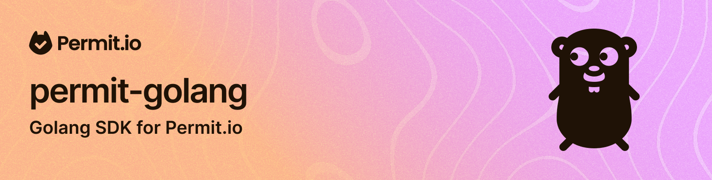

# Go SDK for Permit.io

Instructions for installing Go SDK for interacting with Permit.io.

## Overview

This guide will walk you through the steps of installing the Permit.io Go SDK and integrating it
into your code.

## Installation

Install the SDK using the following command:

```shell
go get github.com/permitio/permit-golang
```

The SDK requires Go 1.19 or later. CI tests it on Go 1.19 and Go 1.27.

Put the package under your project folder and add the following in import:

```golang
import "github.com/permitio/permit-golang/pkg/permit"
```

## Usage

### Init the SDK
To init the SDK, you need to create a new Permit client with the API key you got from the Permit.io
dashboard.

First we will create a new Config object so we can pass it to the Permit client.

Second, we will create a new Permit client with the Config object we created.

```golang
package main

import "github.com/permitio/permit-golang/pkg/permit"
import "github.com/permitio/permit-golang/pkg/config"

func main() {
	PermitConfig := config.NewConfigBuilder("<YOUR_API_TOKEN>").Build()
	Permit := permit.New(PermitConfig)
	_ = Permit // call the methods shown below on Permit
}
```

### API URL and PDP URL
The client sends requests to two URLs, the API URL and the PDP URL. An OPA URL, if you set one,
replaces the PDP URL:

- The API URL, set with `WithApiUrl`, defaults to `https://api.permit.io`. `SyncUser` and every
  method under `Permit.Api` and `Permit.Elements` use it, as does the request that reads the
  project and environment of your API key.
- The PDP URL, set with `WithPdpUrl`, defaults to `http://localhost:7766`, a PDP running on the
  same machine. Only `Check`, `BulkCheck`, `FilterObjects`, `AllTenantsCheck`,
  `GetUserPermissions` and `GetUserPermissionsWithOptions` use it. If you set an OPA URL with
  `WithOpaUrl`, these methods use that URL instead.

### API key levels
An API key belongs to an environment, a project or an organization. Methods that work in an
environment, such as `SyncUser` and the `Permit.Api.Users`, `Permit.Api.Tenants` and
`Permit.Api.Roles` methods, need the client to know the project and the environment:

- Environment API key: nothing to set. The client reads the project and the environment from the
  key on its first call.
- Project API key: call `Permit.Api.SetContext(ctx, "<project>", "<environment>")` with the key's
  project and the environment to use.
- Organization API key: call `Permit.Api.SetContext(ctx, "<project>", "<environment>")` with the
  project and the environment to use. The `Permit.Api.Projects` methods do not need it.

Call `SetContext` once, after `permit.New` and before the other calls. It does not return an
error: when it fails, it logs the error and clears the project and environment that an earlier
call set.

### Check for permissions
To check permissions with the `Permit.Check()` method, build a user and a resource with the
builders in the `github.com/permitio/permit-golang/pkg/enforcement` package.

Follow the example below:

```golang
package main

import (
	"fmt"

	"github.com/permitio/permit-golang/pkg/config"
	"github.com/permitio/permit-golang/pkg/enforcement"
	"github.com/permitio/permit-golang/pkg/permit"
)

func main() {
	permitConfig := config.NewConfigBuilder("<YOUR_API_TOKEN>").Build()
	Permit := permit.New(permitConfig)

	user := enforcement.UserBuilder("user_id").Build()
	resource := enforcement.ResourceBuilder("resource_type").Build()
	permitted, err := Permit.Check(user, "read", resource)
	if err != nil {
		// The check failed, for example because the PDP could not be reached; this is not a deny.
		fmt.Println(err)
		return
	}
	if permitted {
		// Let the user read the resource
	} else {
		// Deny access
	}
}
```

### Sync users
To sync users to the Permit.io API, using the `Permit.SyncUser()` method,
you will have to create a User model using our main Models package.
The models are located in `github.com/permitio/permit-golang/pkg/models`

Follow the example below:
```golang
package main

import (
	"context"
	"fmt"

	"github.com/permitio/permit-golang/pkg/config"
	"github.com/permitio/permit-golang/pkg/models"
	"github.com/permitio/permit-golang/pkg/permit"
)

func main() {
	ctx := context.Background()
	PermitConfig := config.NewConfigBuilder("<YOUR_API_TOKEN>").Build()
	Permit := permit.New(PermitConfig)

	newUser := models.NewUserCreate("new_user")
	user, err := Permit.SyncUser(ctx, *newUser)
	if err != nil {
		fmt.Println(err)
		return
	}
	fmt.Println(user.Key)
}
```
